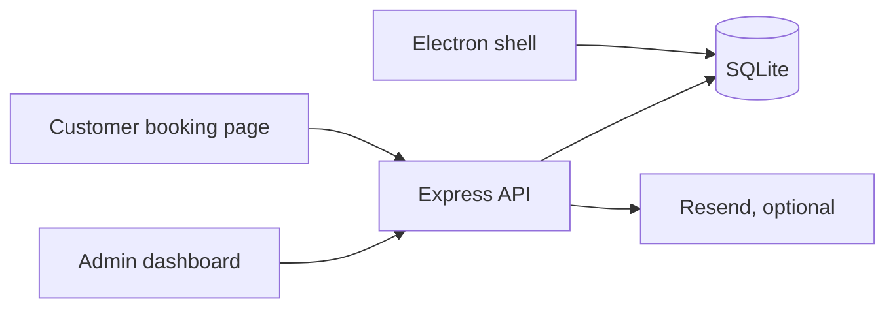

# Salon Booking System

A German-language appointment booking prototype for small salons. It combines a customer-facing booking page, an authenticated administration dashboard, a macOS Electron shell, SQLite persistence and optional email notifications.

> **Portfolio status:** functional prototype, not a production SaaS. Do not use real customer data without an independent security, privacy and operational review.

## What it demonstrates

- Public service catalogue, available time slots and booking requests
- Admin workflow for appointments, customers, services and opening hours
- Calendar, revenue statistics and blocked dates
- SQLite persistence with conflict detection
- Optional transactional email through Resend
- Browser-based administration and a macOS Electron desktop shell
- Explicit separation between public booking routes and authenticated admin routes

## Architecture



| Area | Technology |
| --- | --- |
| Server | Node.js 20, Express |
| Desktop | Electron |
| Persistence | SQLite via better-sqlite3 |
| Frontend | HTML, CSS and vanilla JavaScript |
| Email | Resend |
| Verification | Node test runner, GitHub Actions |

## Run locally

Requirements: Node.js 20+ and npm.

```bash
npm ci
cp .env.example .env
```

Replace every placeholder in `.env`. Generate a session secret with:

```bash
openssl rand -hex 32
```

Start the web application:

```bash
npm run start:server
```

- Booking page: `http://localhost:3456/public/booking.html`
- Admin login: `http://localhost:3456/login.html`

Start the Electron application on macOS:

```bash
npm start
```

The repository intentionally does not include a DMG packaging tool while its dependency chain has unresolved security advisories. The desktop shell remains available for local development through `npm start`.

## Configuration

| Variable | Required | Purpose |
| --- | --- | --- |
| `ADMIN_USER` | Yes | Admin login name |
| `ADMIN_PASS` | Yes | Admin password, at least 12 characters |
| `SESSION_SECRET` | Yes | Session signing secret, at least 32 characters |
| `PORT` | No | HTTP port, defaults to `3456` |
| `HOST` | No | Bind address, defaults to `127.0.0.1`; use `0.0.0.0` only when network access is intended |
| `DATABASE_PATH` | No | Custom SQLite file location |
| `RESEND_API_KEY` | No | Enables email delivery |
| `RESEND_FROM_EMAIL` | No | Verified sender/owner address |

Secrets remain in the server environment. The admin settings API does not return or accept the Resend API key.

## Security boundaries

- Admin routes require a valid session, including requests originating from localhost.
- The server rejects missing, weak or placeholder admin credentials at startup.
- Login attempts are rate-limited in memory.
- Session cookies are HTTP-only and SameSite; production cookies require HTTPS.
- Wildcard CORS is disabled and baseline defensive headers are set.
- `.env`, databases and build output are ignored by Git.

This prototype still uses the in-memory Express session store and has not completed a professional penetration test or GDPR review. See [SECURITY.md](SECURITY.md) before deploying it beyond a trusted demo environment.

## Tests

```bash
npm test
```

The automated checks cover public availability, defensive headers, authentication, session cookies and secret handling. CI runs them on every push and pull request.

## Project status

The application is suitable as a technical portfolio prototype. Production use would additionally require a persistent session store, CSRF strategy, complete input validation, comprehensive authorization and abuse tests, backup/restore procedures, monitoring, and a documented privacy/deletion process.

## License

No open-source license is currently granted. The source is visible for portfolio review; all rights are reserved by the author until a license is added.
